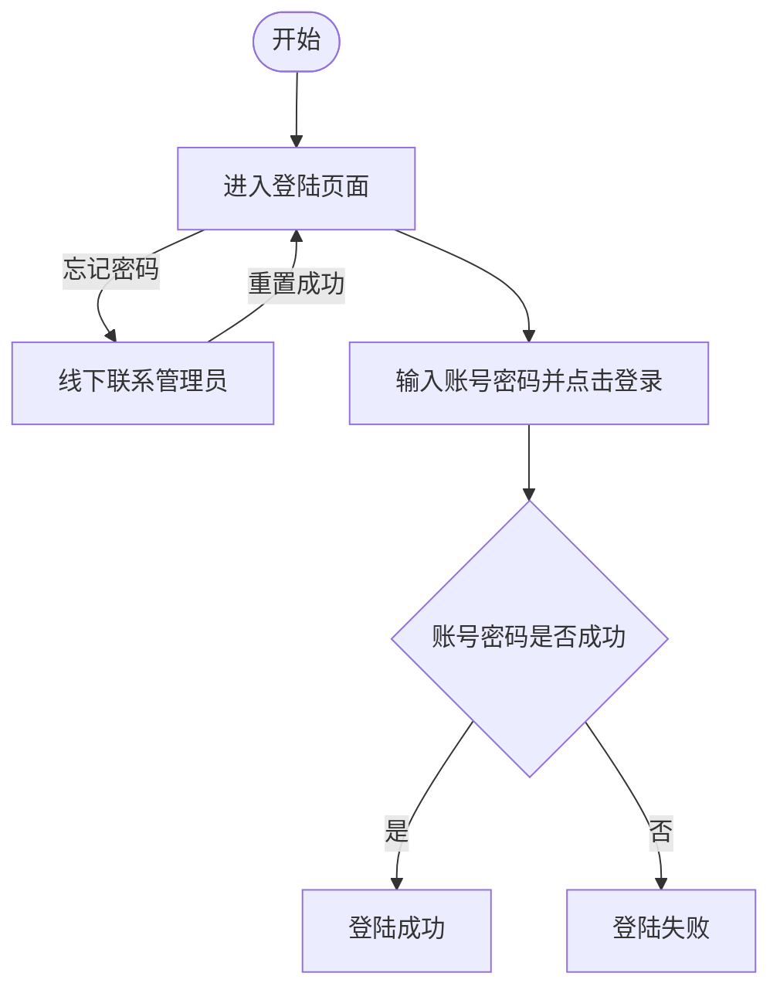
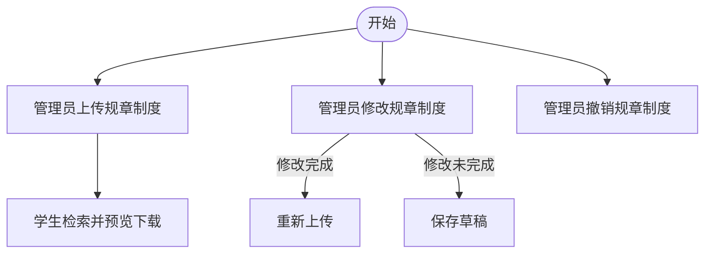
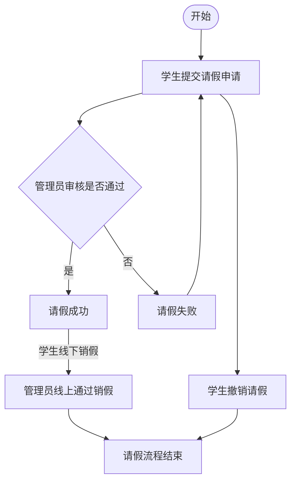
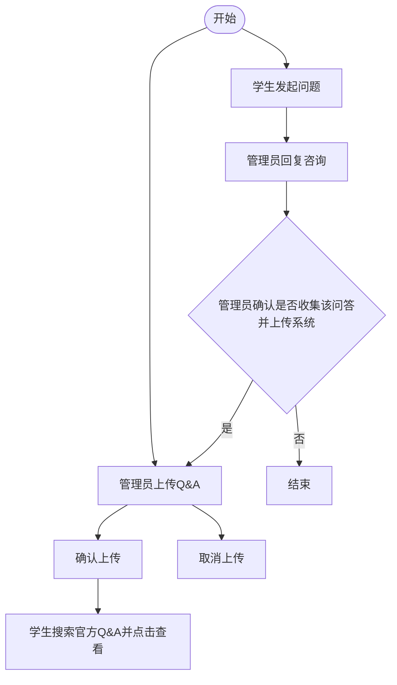
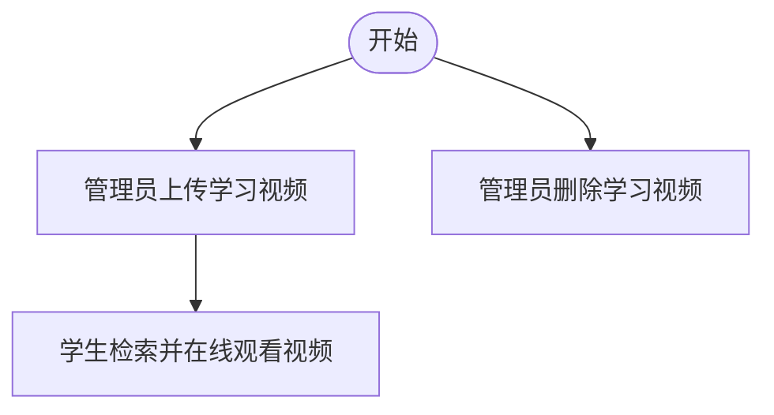
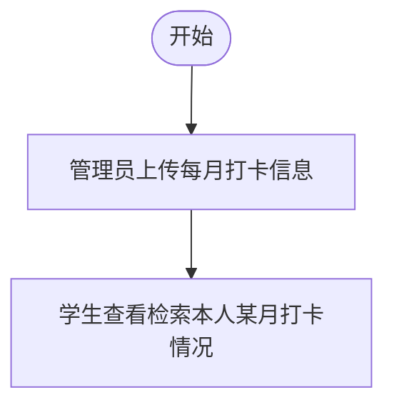
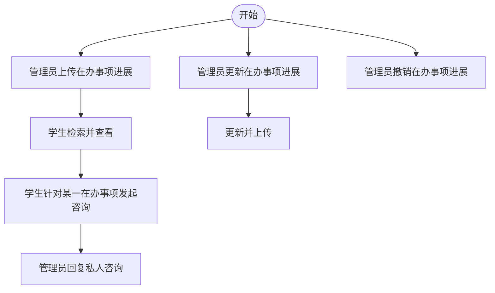

# 需求文档

## 整体需求

本项目拟开发一个面向研究生和管理人员的研究生事务管理与服务平台，集中提供规章制度查阅、请销假办理、业务咨询、视频学习、打卡记录查询及在办事项进展查询等功能。平台通过统一入口，为学生获取信息、办理事务和咨询问题提供便利，同时支持管理员开展信息发布、内容维护、申请审核和咨询回复等工作。

系统设置**学生**和**管理员**两类用户角色，根据角色分配相应的功能权限，具体需求如下：

1. **用户登录与身份验证**  
   系统应支持用户通过账号和密码登录，并对账号密码进行校验。验证通过后，用户进入相应角色的功能界面；验证失败时，系统应提示登录失败，并允许用户重新输入。用户忘记密码时，应通过线下联系管理员的方式重置密码，重置完成后可重新登录。

2. **规章制度管理与查阅**  
   系统应支持管理员上传、修改和撤销规章制度。修改尚未完成时，管理员可保存草稿，待修改完成后重新上传发布。学生可检索、在线预览和下载已发布的规章制度。未发布的草稿不对学生开放，已撤销的制度不再作为有效制度提供查阅和下载。

3. **请假与销假管理**  
   系统应支持学生在线提交请假申请，由管理员审核，并记录申请及审核结果。审核通过后，请假申请生效；审核未通过时，学生可重新提交申请。系统应支持学生撤销请假申请，撤销后结束本次办理流程。请假获批的学生应在线下完成销假，由管理员在线确认销假，确认后结束本次请销假流程。

4. **官方问答与在线咨询**  
   系统应支持管理员上传官方问答，并在发布前进行确认或取消操作。学生可搜索和查看已发布的官方问答，也可针对具体问题发起咨询，由管理员回复。管理员可根据问题的普遍性和参考价值，将咨询内容整理后纳入官方问答库，供学生查询。

5. **学习视频管理与观看**  
   系统应支持管理员上传和删除学习视频。学生可检索已发布的学习视频，并进行在线播放和观看。视频删除后，不再向学生提供检索和播放入口。

6. **月度打卡信息查询**  
   系统应支持管理员按月上传学生打卡信息。学生可按月份检索和查看本人的打卡情况。系统应限制打卡信息的访问范围，确保学生仅能查询本人的记录。

7. **在办事项进展查询与咨询**  
   系统应支持管理员上传、更新和撤销在办事项进展信息，学生可检索并查看已发布的事项及其最新进展。学生可针对某一在办事项发起私人咨询，由管理员进行回复，咨询内容仅向相关学生和有权限的管理员开放。

系统应保证各模块的信息准确保存、业务状态清晰展示，并根据用户角色和数据归属进行访问控制。密码重置和学生销假采用线下办理、线上衔接的方式，其中销假结果由管理员在线确认。请假申请允许撤销的具体状态等业务细则，应在详细需求中进一步明确。

## 流程图

### 登陆界面流程图

### 规章制度下载流程图

### 请销假流程

### Q&A业务流程

### 视频学习业务流程

### 打卡信息查看流程

### 工作信息查看

